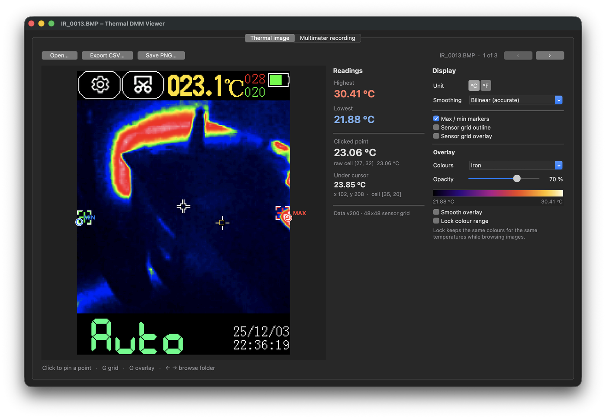
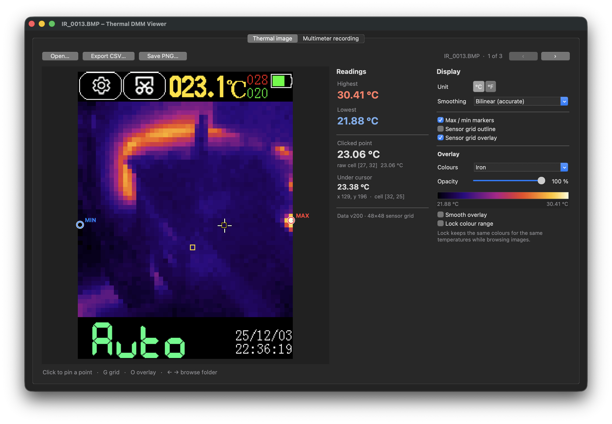
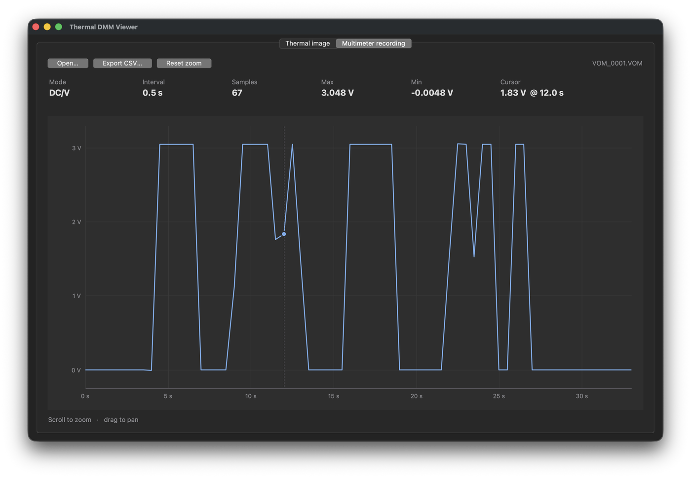

# Thermal DMM Viewer

[](https://github.com/serniko97/thermal-dmm-viewer/actions/workflows/tests.yml)

An open-source, cross-platform viewer for the files saved by **thermal-imaging
multimeters** such as the **ToolTop ET13S** and the **FeelElec FR01** series.
It's an alternative to the vendor's Windows-only *IR-DMM* software, with
correct interpolation, a sensor-grid overlay and a command-line mode.



> Not affiliated with FeelElec or ToolTop. Product names are used only to
> describe compatibility.

## Features

- **Read temperatures anywhere** on a thermal screenshot: click to pin a point,
  hover for a live reading, see the hottest and coldest spots.
- **See what the sensor actually measured:** a sensor-grid outline and a
  false-colour overlay of the raw 48×48 data, with 7 palettes and an opacity slider.
- **Accurate by default:** proper bilinear interpolation, plus a mode that
  reproduces the vendor software bit-for-bit (see [Smoothing modes](#smoothing-modes)).
- **Multimeter recordings** (`.vom`) as a zoomable chart.
- **Export** to CSV and PNG.
- **Command line:** statistics (min, max, mean, median, …), JSON output, batch PNG
  export, no window needed.
- **Runs anywhere Python does:** one file, standard library only. Native look on
  Windows and macOS, GNOME-style light/dark theme on Linux.

| Sensor-grid overlay | Multimeter recording |
| --- | --- |
|  |  |

*Screenshots: macOS in dark mode, using the files in [`samples/`](samples/).*

## Supported devices

| Meter | Sensor | File format | Status |
| --- | --- | --- | --- |
| ToolTop ET13S, FeelElec FR01D, Mustool MT13S | 192×192 | sensor grid in the file | **Tested** with real files |
| ToolTop ET12S, FeelElec FR01C | 90×120 | most likely the older colour-scale format | **Experimental**: not yet tested with a real file |
| ToolTop ET11S, FeelElec FR01A/B | 24×32 | most likely the older colour-scale format | **Experimental**: as above |

The older models seem to use a different way of storing temperatures: the
values are hidden in the colours of the picture rather than in a data block.
The viewer reads it, marks it as experimental, and greys out the features that
need a sensor grid. Details are in the [technical notes](docs/technical.md#older-colour-scale-format-bmp-experimental).

**If you own an ET11S, ET12S or FR01A/B/C**, please try it and
[open an issue](https://github.com/serniko97/thermal-dmm-viewer/issues) with a
zipped original `.bmp` (zip it so it isn't converted on upload) and a photo of
the meter's screen showing the same image. That's how the experimental support
becomes tested support.

## Installation

You need **Python 3.8 or newer** with tkinter (Python's built-in GUI toolkit):

- **Windows / macOS:** the installers from [python.org](https://www.python.org/downloads/) include tkinter.
- **Linux:** install it from your package manager if it's missing:
  `sudo apt install python3-tk` (Debian/Ubuntu), `sudo dnf install python3-tkinter`
  (Fedora), `sudo pacman -S tk` (Arch).

Then either download [`thermal_dmm_viewer.py`](thermal_dmm_viewer.py) and run it:

```
python thermal_dmm_viewer.py
```

or install it as a command:

```
pip install git+https://github.com/serniko97/thermal-dmm-viewer
thermal-dmm-viewer
```

The command-line mode works without tkinter and without a display.

## Getting files off the meter

1. On the meter, open Settings and turn on **USB mode**.
2. Connect it to the computer with the USB-C cable. A drive called **FEELELEC** appears.
3. Copy the `.bmp` and `.vom` files to your computer.

Use the original `.bmp` files. Converting them to JPG or PNG, or editing them,
throws away the hidden temperature data. To try the tool without a meter, use
the sample in [`samples/`](samples/).

## Using the viewer

```
python thermal_dmm_viewer.py                      # start empty
python thermal_dmm_viewer.py samples/IR_0013.BMP  # print a summary and open the image
python thermal_dmm_viewer.py record.vom           # same for a multimeter recording
```

The window is resizable, and the image always fills the space it has, with
crisp pixels at any size.

**Terminal log:** when the viewer is started from a terminal, every file it
opens prints its summary there (Open…, Previous/Next), the same
summary as at start-up. Start it with `-q` to keep the terminal quiet.

### Thermal image tab

**Measuring**

- **Click** on the thermal area to pin a measurement point. Its sensor cell is outlined in yellow.
  **Hover** to read the temperature under the cursor.
- **Highest / Lowest** are the extremes of the sensor data, marked on the image as MAX and MIN.
- **Clicked sensor cell (raw)** shows the unprocessed value of the sensor cell under the
  clicked point, with its row and column. **Position** shows the pixel and cell under the cursor.
- **Smoothing** chooses how the low-resolution sensor grid is stretched to the 240×240
  image. See [Smoothing modes](#smoothing-modes).
- **Unit** switches between °C and °F.
- **Previous / Next** (or the ← → keys) step through the other `.bmp` files in the same
  folder. The clicked point stays in place, so you can compare the same spot across shots.

**Display** (right-hand panel, also in the **View** menu)

- **Sensor grid outline** draws a thin line around every sensor cell (5×5 screen pixels
  each). The lines are light on dark areas and dark on bright ones, so they stay visible
  on any colours. With the outline or overlay on, the cell under the cursor is
  highlighted in yellow.
- **Sensor grid overlay** paints a false-colour picture made directly from the sensor
  grid, one flat block per cell, on top of the meter's image. It shows exactly what was
  measured and where, without the meter's own smoothing.
  - **Opacity** slider: 0 % shows only the meter's image, 100 % only the overlay.
  - **Colours**: Iron, Rainbow, White hot, Black hot, Hot highlights (grey with the
    hottest 20 % in red/yellow), Viridis (colour-blind friendly), Cold-hot (blue–white–red).
    The colour bar underneath shows the temperature range.
  - **Smooth overlay** uses the selected smoothing mode instead of flat blocks.
  - **Lock colour range** keeps the current min–max colour scale when you move to other
    images, so the same colour means the same temperature across a series.

**Menus and shortcuts**

- **File**: open images or recordings, previous/next image, export CSV, **save the
  thermal view as PNG** (with overlay and grid), quit. The PNG uses a whole-number
  zoom (at least 2×, otherwise close to the on-screen size) so every sensor cell has
  the same size in the file.
- **View**: every display option, palette, opacity presets, smoothing and unit.
- Keys: **G** grid outline, **O** overlay, **L** log scale (recordings), **← →** previous/next image,
  **Ctrl+O** open, **Ctrl+Q** quit (**⌘O** on macOS, where Quit is in the app menu).
- **Export CSV** saves either one value per pixel (240×240, using the current
  smoothing mode) or the raw 48×48 sensor grid.

### Multimeter recording tab

- Shows mode, sample interval, number of points, maximum and minimum.
- **Mouse wheel** zooms the time axis around the cursor. **Drag** pans. **Reset zoom** shows everything.
- Hovering shows the time and value of the nearest sample.
- Values switch from mV to V when the recording's maximum is above 1000 mV, like the original.
- **Log scale** (checkbox, **L** key or View menu) shows small and large readings
  together, e.g. a few millivolts of offset next to a 3 V signal. It's a
  *symmetric* log scale: logarithmic away from zero but linear within ±1 mV of it,
  so 0 V and negative readings still appear (a plain log scale can't show them).
  Each labelled step (0.001, 0.01, 0.1, 1 V…) is ten times the previous one.
- **Export CSV** writes `time_s,value_mV`.

### Appearance

| System | Default look |
| --- | --- |
| Windows | Native Windows controls |
| macOS | Native macOS (Aqua) controls, including dark mode |
| Linux | Flat GNOME/libadwaita-style theme. Follows GNOME's dark-mode setting and uses the desktop font (Cantarell, Inter, Noto Sans, Ubuntu… when installed) |

Override it with `--theme`:

```
python thermal_dmm_viewer.py --theme dark      # flat dark theme (any OS)
python thermal_dmm_viewer.py --theme light     # flat light theme (any OS)
python thermal_dmm_viewer.py --theme native    # the OS's own controls (Windows/macOS)
```

Tk, the GUI toolkit built into Python, doesn't use GTK, so on Linux the
window can't take on your exact GTK theme. The flat theme is a close imitation
of GNOME's default look.

## Command line

Any file given on the command line is summarised in the terminal; add
`--no-gui` (or `-n`) to stop there. While the window is open, each file you open
in it is summarised in the terminal too (`-q` turns this off).

```
python thermal_dmm_viewer.py *.bmp --no-gui            # statistics for each image
python thermal_dmm_viewer.py IR_0013.BMP -n --at 120,153   # temperature at a pixel
python thermal_dmm_viewer.py *.bmp --json > stats.json # for scripts
python thermal_dmm_viewer.py *.bmp -n --png "{name}_overlay.png" --overlay --grid
python thermal_dmm_viewer.py csv IR_0013.BMP           # temperatures to CSV
```

See the [command-line reference](docs/command-line.md) for every option and an example summary.

## Smoothing modes

The meter saves temperatures as a **48×48 grid**, even on models with a
192×192 sensor. Each grid cell covers a 5×5 block of screen pixels, so the
values have to be interpolated to give a reading for every pixel.

| Mode | What it does | When to use it |
| --- | --- | --- |
| **Bilinear (accurate)** (default) | Standard bilinear interpolation. Each sensor value sits at the centre of its 5×5 block and each pixel blends the 4 nearest cells. | Normal use |
| **Same as vendor software** | Matches the vendor software exactly, flaws included | Comparing with readings taken in the vendor software |
| **Raw sensor cells** | No interpolation. Each pixel shows the value of the cell it is in. | Seeing exactly what the meter recorded |

**Why the default differs from the vendor software.** The vendor software's
smoothing blends the cells *on either side* of each position and gives the
cell itself no weight. Small hot spots therefore read too low: a component that
covers a single sensor cell can read as ambient temperature when you click
right on it. Near the image edges it also extrapolates past the last cell, so
readings can be slightly above the true maximum or below the true minimum.
Bilinear mode has neither problem: at the centre of each block it returns that
cell's value exactly, and it never goes outside the measured range.

All three modes use the same data. Highest / Lowest temperature and the raw
cell readout do not depend on the smoothing mode.

## Firmware

The meter updates itself from an encrypted `UPDATA.FED` file; there is no open
firmware. The [firmware notes](firmware/README.md) document how updating works,
an analysis of the update file (it's encrypted, with the key inside the meter),
what that rules out, and the hardware route that could lead further. A
standard-library analysis tool is in [`firmware/tools/fedtool.py`](firmware/tools/fedtool.py).

## Accuracy

The tool reads exactly what the meter stored. On real ET13S files the meter's
own centre-spot reading matches the stored centre cell within 0.1–0.2 °C, and
the meter's max/min markers line up with the tool's. Details, the file format and
how this was verified are in the [technical notes](docs/technical.md).

This is a measurement aid, not a calibrated instrument. The meter's own
specified accuracy is ±2 °C or ±2 %.

## Troubleshooting

- **"No embedded temperature data (plain BMP)"**: the file was converted or
  edited, or it isn't a thermal screenshot. Copy the original file from the meter again.
- **"Unrecognised temperature block…"**: your meter's firmware uses a format
  this tool doesn't know yet. Please [open an issue](https://github.com/serniko97/thermal-dmm-viewer/issues) with the full
  message and, if possible, a sample `.bmp` (zip it so it isn't converted on upload).
- **`ModuleNotFoundError: No module named 'tkinter'`**: see [Installation](#installation).

## Contributing

Bug reports, test results from other meter models and sample files are very
welcome. Zip `.bmp` files before attaching them, so they aren't converted on
upload. Run the tests before sending changes:

```
python -m unittest discover -s tests -v
```

## License

[MIT](LICENSE). Use, modify and share freely, with no warranty.
